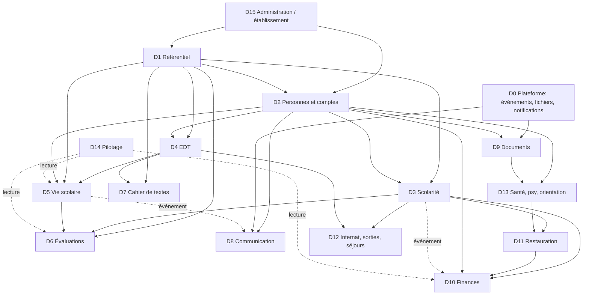

# Cartographie fonctionnelle de l'ENT ScolIA

Date : 2026-11-04. Branche `ENT`. Document opérationnel : sert à développer un ERP cohérent, pas une collection de modules.
Sources lues : `CLAUDE.md`, `docs/VISION.md`, `PRODUCT_SPEC.md`, `DOMAIN_MODEL.md`, `ROADMAP.md`, `DECISIONS.md`, `PROJECT_STATUS.md`, puis le code (chemins cités).

Convention : **[F]** = fait vérifié dans le code (chemin) ; **[P]** = proposition, non décidée (à valider par Florian). Aucune compilation ni test n'a été lancé pour ce document ; les nombres viennent de `grep`/`wc` sur l'état du dépôt à `44aeb64b`.

## 0. Faits de base du dépôt

| Sujet | Fait [F] | Chemin |
|---|---|---|
| Backend | axum 0.8 + sqlx ; 268 déclarations `.route(` ; 376 `async fn` de handlers ; 11 155 lignes | `ent-rust/crates/ent-api/src/routes.rs` |
| Service métier | un seul gros service `PgEnt` (≈ 60 repos injectés) : 16 442 lignes, 419 `pub async fn`, ≈ 295 variantes `*_for_actor` (droits + orchestration) | `ent-rust/crates/ent-db/src/service.rs` |
| Persistance | 54 fichiers `*_repo.rs` (un repo ≈ un agrégat) ; **91 migrations** `001`…`091`, ~100 tables `ent_*` | `ent-rust/crates/ent-db/src/`, `ent-rust/migrations/` |
| Règles pures | 55 modules sans I/O (commandes, validations, PDF, exports réglementaires) | `ent-rust/crates/domain-eleve/src/` |
| Événements | 151 constantes de types (`eleve.created`, `fac.*`, `vs.*`…) ; bus mémoire + écriture dans `ent_metier_event` (payload JSONB non typé) ; **un seul abonné** : le Brain (`ent-brain`), qui réagit à `appel.closed` et `eleve.created` | `ent-events/src/lib.rs`, `ent-db/src/event_store.rs`, `ent-brain/src/react.rs` |
| Rôles | 10 rôles fixes : admin, direction, administratif, cpe, compta, prof, infirmerie, psy, parent, eleve ; ~30 gestes `can_*` | `ent-auth/src/roles.rs` |
| DTO partagés | `ent-types` ne couvre que **3 sujets** (appel, auth, edt) ; tous les autres DTO sont dans `ent-api/src/dto.rs` (3 873 lignes) ; le client Leptos redéclare ses propres types | `ent-types/src/`, `ent-api/src/dto.rs`, `web/crates/ent-web-api/src/` |
| Frontend Leptos | 4 modules : connexion (mot de passe + passkey), accueil « Aujourd'hui », emploi du temps, appel (≈ 2 900 lignes). Navigation à 3 entrées filtrées par droits | `web/crates/ent-web-app/src/modules/`, `noyau/navigation.rs` |
| Ancienne UI JS | 54 170 lignes, une page unique ; écrans par rôle (cf. §0.1) ; **à remplacer module par module, jamais à étendre (F-001)** | `ent-api/src/ui.rs` (fonction `navHtml`, l. ~24782) |
| Établissement | `etablissement_id UUID` partout, **aucune table `ent_etablissement`** ; paramètres en clé/valeur (`ent_param_etab`) | `migrations/076_param_salle.sql` |
| Chantiers en cours | trois worktrees ouverts sur `44aeb64b` : `v2-l3`, `v2-referentiel`, `v2-viescolaire` (non lus ici) | `.claude/worktrees/` |
| Mobile | 4 prototypes non compilables, à fusionner (D-003) | `ent-rust/apps/` |

### 0.1 Écrans de l'ancienne UI par rôle [F] (`ui.rs`, `navHtml`)

| Portail | Entrées |
|---|---|
| Parent (`/famille`) | Mes enfants, Accueil, Vie scolaire, Santé, Journal, Internat, Accompagnement, Cahier, Messages, Docs à signer, Factures, Quittances, Repas, Sorties, Orientation, Réinscription, Sécurité |
| Élève (`/eleve`) | Accueil, Cahier, Messages, Notes, EDT, Absences, Vie scolaire, Sorties, Docs à signer, Mes documents, Santé, Repas, Internat, Stages, Orientation, Journal, Sécurité |
| Admin/direction/administratif | Administration (Élèves, Foyers, Adultes, Établissement, RH, Mails/SMS) ; Vie scolaire ; Pédagogie (Notes, Cahier, Compétences, EDT, Conseils, Exports EN, Stages) ; Famille & services (Messages, Facturation, Bourses, Cantine, Internat, Docs à signer, Annonces) ; Santé ; Inscriptions/Réinscription |
| CPE | Vie scolaire (Aujourd'hui, Appel, Absences & commissions, Sorties, Dispenses, Alertes, Éditions VS), Pédagogie réduite, Santé |
| Prof | Élèves, Appel, Mon EDT, Absences, Cahier, Notes, Compétences, Stages |
| Compta | Élèves, Foyers, Facturation, Bourses, Cantine, Internat |
| Infirmerie / Psy | Santé (Infirmerie / Psy) |

---

## 1. Domaines

Légende maturité : **Back** = backend Rust (absent / embryonnaire / fonctionnel) ; **Leptos** = frontend (absent / partiel / fait) ; **Ancienne UI** = écran dans `ui.rs` (oui / non / partiel). « Fonctionnel » = routes + repo + règles pures + tests locaux ; **jamais** « validé pilote » (rien ne l'est, cf. `PROJECT_STATUS.md`).

Liste des domaines (14 demandés + 2 ajoutés pour les besoins réels d'un établissement) :

| N° | Domaine | N° | Domaine |
|---|---|---|---|
| D1 | Référentiel structure (+ calendrier scolaire) | D9 | Documents et signatures |
| D2 | Personnes et comptes | D10 | Finances |
| D3 | Inscriptions, réinscriptions, scolarité | D11 | Restauration |
| D4 | Emplois du temps | D12 | Internat, sorties, séjours et stages |
| D5 | Vie scolaire | D13 | Santé, psychologie, orientation |
| D6 | Évaluations | D14 | Pilotage / direction |
| D7 | Cahier de textes et devoirs | D15 | Administration (établissement, droits, sécurité, PRA) |
| D8 | Communication | D0 | **Plateforme transverse** (ajouté : événements, journal, fichiers, notifications, recherche) |

Ajouts [P] par rapport à la liste indicative : **D0 Plateforme transverse** (aujourd'hui éparpillé : 3 outbox, journal, fichiers) et le **calendrier scolaire** (vacances, périodes) dans D1, car il conditionne EDT, appel, notes et facturation.

---

### D1 — Référentiel structure

| Champ | Contenu |
|---|---|
| Périmètre | Établissement et sites, années scolaires, périodes (trimestres/semestres), vacances, niveaux/MEF, classes, groupes/options, matières, services d'enseignement (prof × matière × classe/groupe × volume), salles, filières. |
| Tables existantes [F] | `ent_matiere` (008), `ent_param_etab` + `ent_salle` (076), `ent_periode_vacances` (073), `ent_note_periode` (022, périodes **de notes**), `ent_filiere` (077), `ent_eleve_option` (015), `ent_eleve_option_annee` (018). **Absents : établissement, année scolaire, niveau, classe, groupe, service d'enseignement.** La classe n'existe que comme texte (cf. §2.3). |
| Rôles | Admin, direction, administratif (écriture) ; tous les rôles staff (lecture) ; parent/élève : lecture de leur propre classe. |
| Règles essentielles | 1) Une classe appartient à une année scolaire et un établissement ; son niveau en découle. 2) Une seule année « courante » par établissement ; les années passées sont en lecture seule. 3) Un groupe est un sous-ensemble d'élèves d'une ou plusieurs classes, daté. 4) Un service d'enseignement relie prof, matière, classe/groupe et année : il est la source des droits « prof de cette classe » et de l'EDT. 5) Un code de classe est unique par (établissement, année). 6) Aucune suppression d'une classe ayant des affectations ou des données (archivage). |
| Dépendances | Consommé par **tous** (D3, D4, D5, D6, D7, D8, D10, D14). Dépend de D15 (établissement). |
| API existantes [F] | `GET /classes/{classe}/effectif`, `GET /classes/{classe}/trombi`, `/matieres` (2), `/salles`, `/vacances` (3), `/filieres`, `/etab/params`, `/note-periodes` (2). |
| API/événements manquants | CRUD années, classes, groupes, affectations, services d'enseignement ; `GET /classes` (liste) ; événements `referentiel.classe_created`, `referentiel.affectation_changed`, `referentiel.annee_opened/closed`. |
| Maturité | Back : **embryonnaire** (matières, salles, vacances, périodes de notes OK ; structure absente) ; Leptos : **absent** ; Ancienne UI : **partiel** (Établissement, pas de gestion de classes). Chantier (b) en cours. |
| **V1 utilisable** | 1) Année scolaire courante + périodes. 2) Niveaux et classes (CRUD, archivage). 3) Affectation élève → classe (datée) avec rattachement aux colonnes texte existantes. 4) Groupes/options simples. 5) Matières et services d'enseignement (prof × matière × classe). 6) Salles. 7) Liste des classes accessible aux autres modules (sélecteur unique). |

### D2 — Personnes et comptes

| Champ | Contenu |
|---|---|
| Périmètre | Élèves, responsables et foyers, personnel, comptes, rôles, identité unique par personne (D-013), invitations, passkeys, SSO. |
| Tables existantes [F] | `ent_eleve` (001), `ent_eleve_periode` (006), `ent_foyer` + `ent_eleve_lien` (007, droits fins `peut_voir_notes/vs/justifier_absence`), `ent_user` + `ent_membership` + `ent_session` (005), `ent_eleve_compte` (014), `ent_eleve_invitation` (039), `ent_login_guard` (084), `ent_password_reset` (085), `ent_passkey_*` (089), `ent_oidc_*` (090), `ent_info_comp_champ/valeur` (072), `ent_absence_rh` (080). **Absents : personne (responsable sans compte), personnel (fiche RH), profil/contact.** |
| Rôles | Admin/direction/administratif (gestion) ; compta (lecture foyers) ; parent et élève (leur périmètre). |
| Règles essentielles | 1) Un lien responsable↔élève porte des droits configurables, jamais déduits du lien familial. 2) Tout accès est cloisonné par établissement côté serveur. 3) Identité de l'élève restituée par niveau (complet / santé / réduit) via `PgEnt::niveau_identite`. 4) Mot de passe Argon2id ; session à jeton opaque ; passkey obligatoire à terme (D-009). 5) Homonymes détectés avant création (`/eleves/homonymes`). 6) Un compte parent est lié par invitation, pas par auto-inscription. |
| Dépendances | Fondation de tous les domaines (identité). D2 → D1 (classe), D3 (statut). |
| API existantes [F] | `/auth/*` (20 routes dont passkey, OIDC, reset), `/auth/me`, `/eleves` (POST, search, labels, homonymes, sans-compte), `/eleves/{id}`, `/eleves/{id}/identite`, `/eleves/{id}/compte/inviter`, `/eleves/comptes/*`, `/foyers` (5), `/eleves/{id}/liens`, `/etablissement/personnel`, `/personnel/*`, `/users/{id}/telephone`, `/users/{id}/email`, `/famille/enfants`. |
| Manquant | Entité **personne** indépendante du compte (responsable sans compte, préinscription pré-remplie D-014) ; fiche personnel (poste, statut, quotité) ; rôles multiples par établissement ; délégation ; routes d'archivage/départ de personnel. |
| Maturité | Back : **fonctionnel** (auth complète ; L3 sécurité des comptes en cours, chantier (a)) ; Leptos : **partiel** (connexion seule) ; Ancienne UI : **oui** (Élèves, Foyers, Adultes, Sécurité). |
| **V1 utilisable** | 1) Connexion + passkey + réinitialisation (fait). 2) Liste/recherche/fiche élève. 3) Foyers et liens responsables avec droits. 4) Provisionnement de comptes personnel et famille en lot. 5) Gestion des sessions/passkeys par l'utilisateur. 6) Réinitialisation par l'admin. 7) Annuaire cloisonné par rôle. |

### D3 — Inscriptions, réinscriptions et scolarité

| Champ | Contenu |
|---|---|
| Périmètre | Demandes/préinscriptions, inscription, réinscription annuelle, montée de classe, changements (classe, régime, MEF, site), sorties/départs, historique de scolarité. |
| Tables existantes [F] | `ent_reinscription_campagne`, `ent_eleve_scolarite_annee`, `ent_eleve_option_annee` (018), `ent_reinscription_exigence_doc` (028), acompte (029), `ent_inscription_suivi` (078), `ent_voeu_inscription` (077), `ent_eleve_periode` (006, historise classe/régime/MEF/site). Pas de table de demande d'admission ni de préinscription. |
| Rôles | Admin/direction/administratif ; parent (réinscription en ligne) ; compta (acompte). |
| Règles essentielles | 1) La montée rapide est une projection N+1 sans valeur juridique ; le passage officiel vient du conseil de classe. 2) Changer de classe ferme la période en cours et ouvre la suivante (une seule période ouverte par attribut). 3) Une réinscription exige les documents définis par l'établissement. 4) Un acompte conditionne la confirmation s'il est configuré. 5) L'historique n'est jamais écrasé. 6) Départ = statut + date, jamais suppression. |
| Dépendances | D3 → D1 (classes cibles), D2 (élève, foyer), D9 (pièces), D10 (acompte, facture). |
| API existantes [F] | `/reinscription/*` (10 routes : campagne, acompte, montée, montée/lot, candidats, exigences, famille/{id}/options/documents/confirmer), `/eleves/{id}/classe`, `/regime`, `/mef`, `/site`, `/sortie`, `/eleves/{id}/periodes`, `/inscriptions/par-etape`, `/eleves/{id}/inscription-suivi`, `/eleves/{id}/voeux`. |
| Manquant | Admission/préinscription publique (formulaire pré-rempli D-014), pièces par demande, relances, tableau d'avancement des campagnes, événements `inscription.*` normalisés. |
| Maturité | Back : **fonctionnel** pour la réinscription, **absent** pour l'admission ; Leptos : **absent** ; Ancienne UI : **oui** (Inscriptions, Réinscription famille). |
| **V1 utilisable** | 1) Ouvrir une campagne de réinscription. 2) Parcours famille (options, documents, confirmation). 3) Suivi par étape côté secrétariat. 4) Montée en lot vers les classes de l'année suivante (après D1). 5) Changement de classe/régime daté. 6) Historique de scolarité sur la fiche. |

### D4 — Emplois du temps

| Champ | Contenu |
|---|---|
| Périmètre | Créneaux hebdomadaires, semaines A/B, exceptions (annulation, remplacement, changement de salle), contraintes, import, salles, export iCal. |
| Tables existantes [F] | `ent_edt_creneau` (021, `classe` TEXT, `matiere_libelle` TEXT, `matiere_id` facultatif, `prof_user_id`, `salle` TEXT), `ent_edt_exception` (042), `ent_edt_calendrier_ab` (048), `ent_edt_import` (060), `ent_edt_contrainte` (083), `ent_salle` (076), `ent_periode_vacances` (073). |
| Rôles | Admin/direction/administratif (gestion) ; cpe (lecture + exceptions) ; prof (mon EDT) ; élève/parent (lecture). |
| Règles essentielles | 1) Un créneau relie classe, matière, prof, salle, jour, heures ; fin > début. 2) Un appel se rattache à un créneau, pas à « classe + jour » libre. 3) Une exception est unique par (créneau, jour). 4) Les vacances neutralisent les créneaux. 5) Les semaines A/B sont définies par un calendrier. 6) Un prof ne peut pas avoir deux créneaux simultanés (contraintes). |
| Dépendances | D4 → D1 (classes, matières, salles, services), D2 (profs). Consommé par D5 (appel), D7. |
| API existantes [F] | `/edt/creneaux` (2), `/edt/mes-creneaux` (+ `.ics`), `/eleves/{id}/edt` (+ `.ics`), `/edt/exceptions`, `/edt/calendrier-ab`, `/edt/import`, `/edt/contraintes`, `/edt/resoudre`. |
| Manquant | Lecture d'un EDT par **classe** et par **salle** ; lien créneau → service d'enseignement ; événement `edt.creneau_changed` consommé par les notifications. |
| Maturité | Back : **fonctionnel** ; Leptos : **partiel** (lecture semaine « mon EDT », pas de gestion) ; Ancienne UI : **oui** (Mon EDT, EDT admin). |
| **V1 utilisable** | 1) EDT enseignant (fait). 2) EDT élève/parent (lecture). 3) Saisie/édition des créneaux par l'admin. 4) Import de fichier. 5) Exceptions (absence/remplacement/salle) visibles côté famille. 6) Export iCal. |

### D5 — Vie scolaire

| Champ | Contenu |
|---|---|
| Périmètre | Appel, absences, retards, justificatifs, signalements/seuils, commissions, incidents, sanctions, carnet de liaison, dispenses, alertes CPE, éditions VS. |
| Tables existantes [F] | `ent_absence_motif` (003), `ent_absence` (004), `ent_appel` + `ent_appel_ligne` (009), `ent_absence_motif_etab` (013), `ent_absence_signal` (012, 035, 043, 061), `ent_retard` (087), `ent_incident_type`, `ent_sanction_type/motif`, `ent_incident`, `ent_sanction` (019), `ent_carnet_entree` (020, 044), `ent_vs_commission` + `_dossier` (054), `ent_dispense_vs` (067), `ent_alerte_cpe` (069), `ent_edition_vs` (081). |
| Rôles | Cpe (cœur) ; prof (appel, incident) ; admin/direction/administratif ; parent (justifier, consulter) ; élève (consulter). |
| Règles essentielles | 1) L'appel est unique par (classe, jour) et se rattache à un créneau ; la clôture publie les absences/retards. 2) Un justificatif parent est accepté ou refusé par la vie scolaire, jamais par la famille. 3) Un seuil d'absences (10 par défaut, constante `SEUIL_ABSENCES_DEFAUT`) ouvre un signal et alerte la famille une seule fois. 4) « Remettre présent » annule le fait d'absence. 5) Un droit parent `peut_voir_vs` / `peut_justifier_absence` borne l'accès. 6) Une sanction a un type, un motif, une trace, un solde de points. |
| Dépendances | D5 → D1 (classes, créneaux), D2 (liens), D4 (créneau d'appel), D8 (alerte famille, carnet), D3 (régime/sortie). Consommé par D6 (conseil), D14. |
| API existantes [F] | `/appels` (4 : ouvrir, lignes, clore), `/eleves/{id}/absences`, `/absences/{id}/justifier|accepter-justificatif|refuser-justificatif|annuler-justificatif|annuler-present`, `/vs/absences`, `/vs/signaux` (4), `/vs/commissions` (3), `/eleves/{id}/incidents`, `/sanctions`, `/vs/incident-types`, `/vs/sanction-types`, `/vs/sanction-motifs`, `/eleves/{id}/retards`, `/eleves/{id}/carnet`, `/carnet/{id}/signer`, `/vs/dispenses`, `/vs/alertes-cpe`, `/editions-vs`, `/eleves/{id}/points-vs`, `/motifs-absence`. |
| Manquant | **Lecture d'un appel sans `POST`** ; statut « dispensé » et commentaire d'appel (PROJECT_STATUS) ; outbox transactionnelle pour la clôture d'appel ; vue « famille » consolidée par enfant ; événement `vs.alerte_famille` typé. |
| Maturité | Back : **fonctionnel** (domaine le plus complet) ; Leptos : **partiel** (appel enseignant fait ; CPE et famille absents, chantier (c) en cours) ; Ancienne UI : **oui** (Aujourd'hui, Absences & commissions, Sorties, Dispenses, Alertes, Éditions ; portail famille Vie scolaire). |
| **V1 utilisable** | 1) Appel enseignant (fait). 2) File « absences à traiter » côté CPE (justificatifs : accepter/refuser). 3) Déclaration et justification côté famille. 4) Retards. 5) Incidents/sanctions simples. 6) Signal de seuil + alerte famille. 7) Carnet de liaison signé. |

### D6 — Évaluations

| Champ | Contenu |
|---|---|
| Périmètre | Périodes de notes, devoirs/évaluations, notes, moyennes, appréciations, compétences, bulletins, conseils de classe, exports (LSU, LSL, Notanet). |
| Tables existantes [F] | `ent_matiere`, `ent_note` (008 + `devoir_id`, `periode_id`), `ent_note_periode`, `ent_devoir` (022, `classe` TEXT), `ent_note_appreciation` (056), `ent_competence_item/evaluation` (088), `ent_conseil_classe` + `_dossier` (071, `classe` TEXT). |
| Rôles | Prof (saisie) ; admin/direction (périodes, bulletins, conseils) ; cpe (lecture, conseil) ; parent (`peut_voir_notes`) ; élève. |
| Règles essentielles | 1) Une période `ouverte` autorise la saisie, `partielle_appreciations` ne verrouille que les notes, `fermee` verrouille tout. 2) Un devoir porte coefficient et barème (`sur`) ; la note est rapportée à ce barème. 3) Moyennes calculées côté domaine (`domain-eleve/src/notes.rs`) avec coefficients. 4) Le parent ne voit que si le lien l'autorise. 5) Le conseil de classe décide par dossier élève et alimente le passage (D3). 6) Les exports réglementaires sont tracés. |
| Dépendances | D6 → D1 (périodes, classes, matières, services), D2, D3 (passage), D5 (absences au bulletin). |
| API existantes [F] | `/note-periodes` (+ statut), `/devoirs`, `/eleves/{id}/notes|moyennes|bulletins|appréciations|devoirs`, `/competences`, `/eleves/{id}/competences|livret-competences`, `/conseils-classe` (4), `/eleves/{id}/conseils`, `/exports/lsl|lsun|onde|notanet|parcoursup`. |
| Manquant | Bulletin agrégé multi-matières en PDF fini (`bulletin_pdf.rs` existe) ; saisie en grille par classe ; ancrage devoir→service d'enseignement ; événement `notes.published` pour notifier. |
| Maturité | Back : **fonctionnel** ; Leptos : **absent** ; Ancienne UI : **oui** (Notes, Compétences, Conseils, Exports EN, vue élève/parent). |
| **V1 utilisable** | 1) Périodes ouvertes/fermées. 2) Création de devoirs par classe. 3) Saisie des notes en grille. 4) Moyennes élève/classe. 5) Appréciations. 6) Consultation famille/élève. 7) Bulletin PDF par période. 8) Conseil de classe simple. |

### D7 — Cahier de textes et devoirs

| Champ | Contenu |
|---|---|
| Périmètre | Contenu des séances, travail à faire, pièces, visibilité élève/parent. |
| Tables existantes [F] | `ent_cahier_texte` (049 : `classe`, `matiere_libelle` en TEXT, `pour_le`, `cree_le`). Les « devoirs » **évalués** sont dans `ent_devoir` (D6) : deux notions homonymes. |
| Rôles | Prof (écriture) ; admin/direction/cpe (lecture) ; élève, parent (lecture). |
| Règles essentielles | 1) Un item de cahier vise une classe (ou un groupe) et une date `pour_le`. 2) Visible des élèves et parents de la classe. 3) Seul l'auteur ou l'administration modifie. 4) Un item doit pouvoir se rattacher à un créneau/service. 5) Les évaluations annoncées apparaissent côté élève. |
| Dépendances | D7 → D1 (classe, matière, groupe), D4 (séance), D2. |
| API existantes [F] | `/cahier-texte` (1 route avec liste et création). |
| Manquant | Modification/suppression ; séance (contenu fait) distincte du travail à faire ; pièces jointes ; rattachement créneau ; `matiere_id` ; notification. |
| Maturité | Back : **embryonnaire** (1 table, 1 route) ; Leptos : **absent** ; Ancienne UI : **oui** (Cahier prof, Cahier élève/famille). |
| **V1 utilisable** | 1) Prof publie le travail à faire pour une classe. 2) Modifier/supprimer. 3) Vue élève/parent par date. 4) Rattachement à la séance de l'EDT. 5) Pièce jointe. 6) Agenda « à faire cette semaine ». |

### D8 — Communication

| Champ | Contenu |
|---|---|
| Périmètre | Messagerie (fils, accusés, pièces, modèles, archivage), annonces ciblées, notifications mail/SMS/push, carnets, campagnes. |
| Tables existantes [F] | `ent_msg_fil`, `ent_msg` (023), `ent_msg_accuse` (037), `ent_msg_piece` (038), `ent_msg_modele` (047), priorité/dossier (050), `ent_annonce` (086), `ent_mail_outbox` (055), `ent_sms_outbox` (057), `ent_push_device` + `ent_push_outbox` (058). |
| Rôles | Tous (messagerie selon droits) ; direction/admin/cpe (annonces) ; admin (mails/SMS). |
| Règles essentielles | 1) Un fil a des participants ; un parent ne contacte que le personnel autorisé. 2) Les pièces jointes sont privées, servies par contrôle d'accès. 3) L'accusé de lecture est tracé. 4) Une annonce a une audience (`tous`, `parents`, `personnels`, `classe`). 5) Les envois sensibles exigent une confirmation humaine (CLAUDE.md). 6) SMS via OVH (D-004), non intégré. |
| Dépendances | D8 → D2 (destinataires), D1 (classe cible), D0 (outbox). Consommé par D5, D10, D3, D9 (alertes). |
| API existantes [F] | `/messages/fils` (liste, détail, répondre, archiver, classer, depuis-modèle), `/messages/modeles`, `/messages/{id}/pieces`, `/annonces`, `/mails`, `/sms`, `/devices/push`. |
| Manquant | Préférences de notification par utilisateur ; événements `msg.*` consommés par un diffuseur unique ; intégration OVH SMS ; push réel ; campagnes ciblées ; recherche. |
| Maturité | Back : **fonctionnel** (messagerie, annonces) ; mail/SMS/push : **embryonnaire** (simulés, SMTP opt-in) ; Leptos : **partiel** (tuiles « messages non lus » et « annonces » sur l'accueil seulement) ; Ancienne UI : **oui** (Messages, Annonces, Mails/SMS). |
| **V1 utilisable** | 1) Boîte de réception/lecture/réponse. 2) Nouveau message avec pièce jointe. 3) Accusés et non-lus. 4) Modèles de message. 5) Annonces ciblées classe/audience. 6) Notification mail des nouveaux messages. 7) Messages parent→établissement. |

### D9 — Documents et signatures

| Champ | Contenu |
|---|---|
| Périmètre | Pièces du dossier élève, droits d'accès aux documents sensibles, documents à signer, PAI/santé (pièces), PDF générés. |
| Tables existantes [F] | `ent_eleve_document`, `ent_document_grant`, `ent_eleve_dispositif` (016), `ent_doc_a_signer` (070), `ent_pai_piece` (053), `ent_msg_piece` (038). Stockage objet : `ent-object` (disque local ; mode S3 partiel, sans URL pré-signée). |
| Rôles | Admin/direction/administratif (dépôt, publication) ; infirmerie/psy (santé) ; parent/élève (consultation, signature). |
| Règles essentielles | 1) Les clés de stockage ne viennent jamais du client ; lecture seulement si la clé appartient au document de l'établissement (vague 1). 2) Un document sensible se lit par **grant** demandé puis décidé. 3) Chaque téléchargement est tracé. 4) La signature est horodatée et rattachée au signataire. 5) URL pré-signées courtes à terme. |
| Dépendances | D9 → D2, D0 (fichiers, journal). Consommé par D3 (pièces), D13 (PAI), D10 (factures PDF). |
| API existantes [F] | `/eleves/{id}/documents`, `/documents/{id}/fichier`, `/documents/{id}/grants`, `/documents/grants/pending`, `/documents/grants/{id}/decider`, `/eleves/{id}/docs-a-signer`, `/vs/docs-a-signer`, `/docs-a-signer` (2). |
| Manquant | Signature électronique valable (aujourd'hui accusé de signature), gabarits, publipostage, URL pré-signées S3, moteur de conversion (D-005). |
| Maturité | Back : **fonctionnel** (local) ; Leptos : **absent** ; Ancienne UI : **oui** (Mes documents, Docs à signer). |
| **V1 utilisable** | 1) Dépôt de pièces au dossier. 2) Consultation selon droits. 3) Demande/décision de grant. 4) Publier un document à signer à une cible. 5) Signature famille. 6) Suivi « qui a signé ». |

### D10 — Finances

| Champ | Contenu |
|---|---|
| Périmètre | Factures, lignes, échéanciers, encaissements, quittances, rappels, SEPA (mandats, prélèvements), bourses, quotient familial, TVA, tarifs de consommation, rapprochement bancaire, export comptable OGEC. |
| Tables existantes [F] | `ent_fac_facture`, `ent_fac_ligne` (024), `ent_fac_encaissement` (025), `ent_fac_echeance` (026, 033), `ent_fac_quittance` (027), `ent_fac_sepa_mandat/prelevement` (030, 031), `ent_fac_rappel` (032), `ent_foyer_quotient`, `ent_taux_tva` (075), `ent_tarif_conso` (079), `ent_foyer_iban_histo` (078), `ent_bank_rapprochement` (059), `ent_bourse_type`, `ent_eleve_bourse` (017). |
| Rôles | Compta, direction, admin (gestion) ; parent (consultation, SEPA). |
| Règles essentielles | 1) Une facture émise est immuable ; correction par avoir. 2) Le foyer est le débiteur, pas l'élève. 3) L'échéancier répartit le montant en parts ; l'encaissement s'impute dessus. 4) Un prélèvement SEPA exige un mandat actif et peut être rejeté avec motif. 5) Les bourses sont décidées avant de réduire l'échéance. 6) Aucune donnée bancaire hors du foyer. |
| Dépendances | D10 → D2 (foyer), D3 (inscription, acompte), D11 (repas facturables), D1 (année). |
| API existantes [F] | `/facturation/*` (21 routes : factures, émettre, encaisser, échéancier, quittances, PDF, SEPA, rappels, export OGEC, banque/rapprocher, cantine/badge), `/bourses/*`, `/eleves/{id}/bourses`, `/foyers/{id}/quotient`, `/foyers/{id}/iban-histo`, `/taux-tva`, `/tarifs-conso`. |
| Manquant | Génération de facture annuelle par campagne ; bourse → échéancier automatique ; connecteur bancaire réel ; événements `fac.*` consommés par les notifications ; vue famille « solde ». |
| Maturité | Back : **fonctionnel** (le plus volumineux : `fac_repo.rs` 1 380 lignes, `facturation*.rs`) ; Leptos : **absent** ; Ancienne UI : **oui** (Facturation, Bourses, Factures, Quittances). |
| **V1 utilisable** | 1) Créer et émettre une facture avec lignes. 2) Échéancier. 3) Encaisser. 4) Quittance PDF. 5) Vue famille des factures/quittances. 6) Relances. 7) Mandat SEPA + export de prélèvements. |

### D11 — Restauration

| Champ | Contenu |
|---|---|
| Périmètre | Activités/services de repas, grilles par élève, dispenses, passages au badge, menus, volume facturable, tarifs. |
| Tables existantes [F] | `ent_repas_activite`, `ent_eleve_grille_repas` (017), `ent_eleve_dispense_repas` (034), `ent_repas_passage` (036), `ent_menu_cantine` (074), `ent_tarif_conso` (079). |
| Rôles | Admin/direction/administratif/cpe (gestion) ; compta (volume) ; scan par rôles autorisés ; parent/élève (consultation). |
| Règles essentielles | 1) Le repas facturable = grille − dispenses datées. 2) Un passage au badge est unique par élève, service et jour. 3) La dispense annule le jour concerné sans effacer l'historique. 4) Le régime (DP/externe) pilote la grille par défaut. 5) Les données d'allergie viennent de D13, pas de D11. |
| Dépendances | D11 → D2, D3 (régime), D10 (facturation), D13 (allergies). |
| API existantes [F] | `/repas/*` (5), `/eleves/{id}/repas/grilles|dispenses|volume|passages`, `/menus-cantine`, `/facturation/cantine/badge`. |
| Manquant | Réservation famille ; export des effectifs cuisine ; événement `repas.volume_valide`. |
| Maturité | Back : **fonctionnel** ; Leptos : **absent** ; Ancienne UI : **oui** (Cantine, Repas). |
| **V1 utilisable** | 1) Définir les services. 2) Grille par élève. 3) Dispenses. 4) Scan au badge. 5) Menu de la semaine. 6) Volume pour facturation. |

### D12 — Internat, sorties et séjours

Note de vocabulaire : dans le code, **« sortie » = autorisation de sortie de l'établissement** (régime, badge, contrôle), pas la sortie scolaire. Les sorties/séjours pédagogiques n'existent pas.

| Champ | Contenu |
|---|---|
| Périmètre | Internat (chambres, affectations, présences, suivi), autorisations de sortie, stages/conventions ; **à créer** : sorties et séjours scolaires. |
| Tables existantes [F] | `ent_internat_chambre/affectation/presence/suivi` (066), `ent_sortie_autorisation/demande/controle` (062), règles par niveau et régime (063, 064), `ent_sortie_param` (065), `ent_entreprise`, `ent_convention_stage` (082). **Absents : séjour, sortie scolaire, transport.** |
| Rôles | Admin/direction/cpe (gestion) ; surveillants (contrôle) ; parent (demande exceptionnelle, autorisation) ; élève. |
| Règles essentielles | 1) La règle de sortie dépend du niveau, du régime et des horaires de l'EDT. 2) Une demande exceptionnelle est tranchée par la VS. 3) Un contrôle au badge est tracé. 4) Une chambre a une capacité ; l'affectation est datée. 5) Un séjour exige autorisation parentale signée et suivi de paiement [P]. |
| Dépendances | D12 → D2, D3 (régime), D4 (horaires), D5 (VS), D9 (autorisations), D10 (paiement séjour). |
| API existantes [F] | `/vs/sorties/*` (7), `/eleves/{id}/sorties`, `/sorties/demandes`, `/vs/internat/*` (4), `/eleves/{id}/internat`, `/internat/suivis`, `/entreprises`, `/conventions-stage`, `/eleves/{id}/conventions-stage`. |
| Manquant | Domaine **séjours/voyages** complet (participants, autorisations, paiement, encadrants) ; transports ; renommage sémantique « sortie établissement ». |
| Maturité | Back : **fonctionnel** (internat, sorties établissement, stages) ; **absent** (séjours) ; Leptos : **absent** ; Ancienne UI : **oui** (Sorties, Internat, Stages). |
| **V1 utilisable** | 1) Autorisation de sortie par élève (famille). 2) Contrôle au badge. 3) Demandes exceptionnelles. 4) Chambres et affectations. 5) Pointage internat du soir. 6) Convention de stage. |

### D13 — Santé, psychologie, orientation

| Champ | Contenu |
|---|---|
| Périmètre | Fiche santé, passages infirmerie, PAI, dossier et rendez-vous psy, orientation (filières, vœux). |
| Tables existantes [F] | `ent_fiche_sante` (045), `ent_infirmerie_passage` (040), `ent_pai` + `ent_pai_piece` (052, 053), `ent_psy_entretien` (041), `ent_psy_rdv` (046), `ent_psy_dossier` (051), `ent_filiere`, `ent_voeu_inscription` (077). |
| Rôles | Infirmerie, psy (écriture) ; admin/direction (lecture restreinte) ; cpe (lecture limitée) ; parent (fiche, PAI). |
| Règles essentielles | 1) Données sensibles : niveau d'identité « santé » ; chaque consultation est journalisée (vague 1). 2) Le dossier psy n'est visible que du psy et de la direction habilitée. 3) Le PAI est signé par la famille. 4) Un passage infirmerie notifie la famille selon règle. 5) Minimisation : aucune donnée santé dans les listes générales. |
| Dépendances | D13 → D2, D9 (pièces), D0 (journal). Consommé par D11 (allergies), D12. |
| API existantes [F] | `/infirmerie`, `/eleves/{id}/fiche-sante` (+ `.pdf`), `/eleves/{id}/pai` (+ `signer`, `pieces`), `/psy` (3), `/eleves/{id}/dossier-psy` (+ courrier PDF/envoi), `/filieres`, `/eleves/{id}/voeux`. |
| Manquant | Registre des médicaments/protocoles ; alerte famille automatique de passage ; vue allergies pour D11 ; politique de conservation. |
| Maturité | Back : **fonctionnel** ; Leptos : **absent** ; Ancienne UI : **oui** (Infirmerie, Psy, Santé, Orientation). |
| **V1 utilisable** | 1) Fiche santé (famille saisit, infirmerie valide). 2) Passage infirmerie avec notification. 3) PAI signé. 4) Rendez-vous psy. 5) Vœux d'orientation. |

### D14 — Pilotage / direction

| Champ | Contenu |
|---|---|
| Périmètre | Tableaux de bord, indicateurs, exports réglementaires, journal d'audit, éditions, copilote. |
| Tables existantes [F] | `ent_journal_modif` (068, 091 : ajout seul), `ent_metier_event` (001), `ent_edition_vs` (081). Exports calculés à la volée (`lsl_export.rs`, `lsun_export.rs`, `onde_export.rs`, `notanet_export.rs`, `parcoursup_export.rs`). |
| Rôles | Direction, admin ; administratif (exports) ; cpe (éditions VS). |
| Règles essentielles | 1) Un export réglementaire est tracé. 2) Les indicateurs respectent les droits (pas de contournement par agrégat). 3) Le journal est en ajout seul. 4) Le copilote n'a jamais plus de droits que l'utilisateur et passe par les services métier. 5) Aucun indicateur sans définition documentée. |
| Dépendances | D14 → tous (lecture via fonctions de service/événements, jamais en SQL direct inter-domaine). |
| API existantes [F] | `/audit/journal`, `/exports/*` (5), `/copilote/ask|capacites`, `/editions-vs`, `/eleves/{id}/journal`. |
| Manquant | Tableau de bord direction (effectifs, absentéisme, impayés, EDT) ; vues matérialisées ou lecture sur événements ; indicateurs documentés. |
| Maturité | Back : **embryonnaire** (exports + journal ; copilote à règles fixes sans LLM) ; Leptos : **absent** ; Ancienne UI : **partiel** (Exports EN, Copilote, Journal). |
| **V1 utilisable** | 1) Effectifs par classe/niveau. 2) Absentéisme par période. 3) Impayés. 4) Journal consultable. 5) Exports LSU/Notanet/ONDE avec trace. |

### D15 — Administration (établissement, droits, sécurité, PRA)

| Champ | Contenu |
|---|---|
| Périmètre | Paramètres, utilisateurs et rôles, SSO, sécurité des comptes, observabilité, inventaire PRA, exploitation. |
| Tables existantes [F] | `ent_param_etab` (076), `ent_membership` (005), `ent_login_guard` (084), `ent_password_reset` (085), `ent_passkey_*` (089), `ent_oidc_*` (090). Hors DB : `ent-obs`, `ent-db/src/pra.rs`. |
| Rôles | Admin (cœur) ; direction (partiel). |
| Règles essentielles | 1) Rôles fixes dans le code ; droits fins en configuration (liens, `can_*`). 2) Un sous-domaine par établissement (D-012). 3) Passkey obligatoire à terme (D-009). 4) Le labo et `/auth/register` sont absents du binaire de production (feature `labo`). 5) Erreurs génériques avec référence ; détail aux journaux. |
| Dépendances | D15 fondation de D0–D14. |
| API existantes [F] | `/health`, `/ready`, `/metrics`, `/pra/inventaire` (+ vérifier), `/auth/oidc/providers`, `/etab/params`, `/etablissement/personnel`, `/auth/users/{id}/passkeys`. |
| Manquant | Table établissement (nom, sites, sous-domaine, calendrier) ; gestion des rôles/permissions par interface ; sessions cookie HttpOnly (L7) ; anti-abus (L5) ; sauvegarde/restauration testées. |
| Maturité | Back : **fonctionnel** pour l'auth, **embryonnaire** pour l'établissement ; Leptos : **absent** ; Ancienne UI : **partiel** (Établissement, Sécurité). |
| **V1 utilisable** | 1) Fiche établissement. 2) Provisionnement du personnel. 3) Gestion des rôles. 4) Sécurité du compte (passkeys, mot de passe). 5) SSO configurable. 6) Santé / métriques. |

### D0 — Plateforme transverse (ajouté)

| Champ | Contenu |
|---|---|
| Périmètre | Bus d'événements, journal d'audit, stockage de fichiers, diffusion (mail, SMS, push), recherche, erreurs, observabilité. |
| Existant [F] | `ent-events` (bus + store), `ent-object`, `ent-mail`, `ent-sms`, `ent-push`, `ent-bank`, `ent-obs`, `ent-brain` (runtime de réactions), `ent_journal_modif`. Trois outbox séparées (055, 057, 058), sans préférences ni modèle commun. |
| Règles | Un événement est publié **après** commit réussi, de préférence via outbox transactionnelle [P] ; un fichier privé n'est servi qu'après contrôle ; un envoi sensible exige confirmation humaine. |
| Manquant | Outbox transactionnelle (risque connu : clôture d'appel sans absences publiées si l'après-commit échoue) ; notifications unifiées ; préférences ; événements typés ; recherche globale. |
| Maturité | Back : **embryonnaire à fonctionnel** ; Leptos/Ancienne UI : sans objet (service). |

---

## 2. Propriété des données et contrats

### 2.1 Tableau de propriété [P] — état constaté [F] et cible

La propriété ci-dessous reprend la répartition réelle des repos (chaque `*_repo.rs` n'écrit que ses tables, vérifié par grep des `INSERT/UPDATE/DELETE`) et la complète pour la cible.

| Domaine | Tables dont il est propriétaire (seul à écrire) | Expose (fonctions de service / DTO / événements) | Consomme |
|---|---|---|---|
| D1 Référentiel | `ent_matiere`, `ent_salle`, `ent_param_etab`, `ent_periode_vacances`, `ent_note_periode` (période : à rapatrier), `ent_filiere`, `ent_eleve_option`, **à créer** : `ent_etablissement`, `ent_annee_scolaire`, `ent_niveau`, `ent_classe`, `ent_groupe`, `ent_affectation_eleve`, `ent_service_enseignement` | `classes_de(annee)`, `classe_par_id`, `eleves_de_classe_au(jour)` ; DTO `ClasseDto`, `GroupeDto` ; `referentiel.*` | D15 (établissement) |
| D2 Personnes/comptes | `ent_eleve`, `ent_eleve_periode`, `ent_foyer`, `ent_eleve_lien`, `ent_eleve_compte`, `ent_eleve_invitation`, `ent_user`, `ent_membership`, `ent_session`, `ent_login_guard`, `ent_password_reset`, `ent_passkey_*`, `ent_oidc_*`, `ent_info_comp_*`, `ent_absence_rh`, `ent_foyer_quotient` (à rapprocher de D10) | `get_eleve`, `liens_de(user)`, `peut_voir(user, eleve, droit)`, `niveau_identite` ; `EleveDto`, `LienDto`, `MeDto` ; `eleve.*`, `foyer.*` | D1 (classe) |
| D3 Scolarité | `ent_eleve_scolarite_annee`, `ent_eleve_option_annee`, `ent_reinscription_*`, `ent_inscription_suivi`, `ent_voeu_inscription` | `scolarite_de(eleve, annee)`, `niveau_effectif` ; `scolarite.*`, `reinscription.*` | D1, D2, D9, D10 |
| D4 EDT | `ent_edt_creneau`, `_exception`, `_calendrier_ab`, `_import`, `_contrainte` | `creneaux_de_classe/prof/salle(jour)` ; `EdtCreneauDto` ; `edt.*` | D1, D2 |
| D5 Vie scolaire | `ent_absence*`, `ent_appel*`, `ent_retard`, `ent_incident*`, `ent_sanction*`, `ent_carnet_entree`, `ent_vs_commission*`, `ent_dispense_vs`, `ent_alerte_cpe`, `ent_edition_vs` | `absences_de(eleve, période)`, `solde_points`, `appel_de(créneau)` ; `AppelDto`, `AbsenceDto` ; `appel.*`, `eleve.absence_*`, `vs.*` | D1, D2, D4 ; D8 par **événement** |
| D6 Évaluations | `ent_note`, `ent_devoir`, `ent_note_appreciation`, `ent_competence_*`, `ent_conseil_classe*` | `notes_de(eleve, période)`, `moyennes`, `bulletin(eleve, période)` ; `notes.*`, `devoir.*` | D1, D2, D3, D5 |
| D7 Cahier | `ent_cahier_texte` | `travail_a_faire(classe, plage)` ; `cahier.*` | D1, D4 |
| D8 Communication | `ent_msg*`, `ent_annonce` | `fils_de(user)`, `envoyer(...)` ; `msg.*`, `annonce.*` | D2, D1 ; D0 (diffusion) |
| D9 Documents | `ent_eleve_document`, `ent_document_grant`, `ent_eleve_dispositif`, `ent_doc_a_signer`, `ent_pai_piece` (à rapprocher de D13) | `document_pour(user, id)`, `a_signer_de(user)` ; `doc.*` | D2, D0 (fichiers) |
| D10 Finances | `ent_fac_*`, `ent_taux_tva`, `ent_tarif_conso`, `ent_foyer_iban_histo`, `ent_bank_rapprochement`, `ent_bourse_type`, `ent_eleve_bourse` | `solde_foyer`, `factures_de(foyer)` ; `fac.*` | D2 (foyer), D3, D11 (volume) |
| D11 Restauration | `ent_repas_*`, `ent_eleve_grille_repas`, `ent_eleve_dispense_repas`, `ent_menu_cantine` | `volume_facturable(eleve, période)` ; `repas.*` | D2, D3, D13 |
| D12 Internat/sorties | `ent_internat_*`, `ent_sortie_*`, `ent_entreprise`, `ent_convention_stage` ; à créer : séjours | `autorisation_sortie_au(eleve, instant)` ; `sortie.*`, `internat.*`, `stage.*` | D2, D3, D4 |
| D13 Santé/psy | `ent_fiche_sante`, `ent_infirmerie_passage`, `ent_pai`, `ent_psy_*` | `allergies_de(eleve)` (niveau santé) ; `infirmerie.*`, `psy.*` | D2, D9 |
| D14 Pilotage | aucune table métier (lit) ; `ent_edition_vs` à rapatrier de D5 | `kpi_*` | tous, en lecture via services/événements |
| D15 Administration | `ent_membership` (partagé D2 : à trancher), `ent_param_etab` (partagé D1) | `etablissement_courant`, `parametre(clé)` | — |
| D0 Plateforme | `ent_metier_event`, `ent_journal_modif`, `ent_mail_outbox`, `ent_sms_outbox`, `ent_push_*` | `publier(evt)`, `notifier(...)`, `journaliser(...)` | — |

### 2.2 Ce que le code fait déjà bien [F]

- Les repos n'écrivent que leurs tables. Seules exceptions : `ent_appel_ligne` (aussi dans `scenarios.rs`, jeu d'essai) et `ent_journal_modif` (aussi `service.rs`, `tests_l6.rs`).
- Règles pures séparées des I/O (`domain-eleve`), droits centralisés (`ent-auth/src/roles.rs`), cloisonnement établissement dans les requêtes, matrice de séparation de 27 tests (`ent-api/tests/separation.rs`).

### 2.3 Violations et dettes constatées [F]

| N° | Constat | Preuve | Gravité | Effet |
|---|---|---|---|---|
| V1 | **La classe est un texte libre dupliqué en 9 endroits**, sans table de classes : `ent_eleve.classe` (001), `ent_eleve_periode` (kind `classe`, 006), `ent_eleve_scolarite_annee.classe` (018), `ent_appel.classe` (009), `ent_edt_creneau.classe` (021), `ent_devoir.classe` (022), `ent_cahier_texte.classe` (049), `ent_conseil_classe.classe` (071), `ent_annonce.cible_classe` (086). La migration `002` a supprimé la table d'effectif au motif que « l'effectif se lit sur `ent_eleve.classe` ». | `migrations/*.sql` | Haute | Typo ou renommage = données orphelines ; pas d'année, de niveau, de groupe ni de prof par classe ; renommage impossible sans migration de 9 tables. |
| V2 | **Année scolaire = texte + fonction codée en dur** : `annee_scolaire_de(jour)` / `debut_annee_scolaire(jour)` (50 usages) calculent l'année d'après la date ; colonnes `annee_scolaire TEXT` (012, 018) et `annee_cible TEXT` (campagne). | `domain-eleve/src/absence.rs:290,300` | Haute | Impossible d'avoir des années aux dates variables, de clore une année, ou d'archiver proprement. |
| V3 | **Matière dupliquée en texte** : `matiere_libelle` dans `ent_edt_creneau` (avec `matiere_id` facultatif) et `ent_cahier_texte` (sans `matiere_id`). `salle` TEXT dans `ent_edt_creneau` alors que `ent_salle` existe. | 021, 049, 076 | Moyenne | Statistiques par matière fausses ; incohérence EDT/notes/cahier. |
| V4 | **Écritures croisées dans l'orchestration** : `apres_absence_ecrite` (D5) écrit les signaux, lit l'auth (`first_member_with_roles`) et crée un fil de messagerie (D8) dans le même service. | `ent-db/src/service.rs:6307` | Moyenne | Domaines couplés par appels directs, pas par événements ; test et réutilisation difficiles. |
| V5 | **Service monolithique** : `PgEnt` contient ≈ 60 repos, 16 442 lignes, 419 fonctions publiques ; droits + orchestration + règles mélangés dans `*_for_actor`. | `ent-db/src/service.rs` | Haute (évolutivité) | Conflits de fusion entre chantiers parallèles ; frontières de domaine non compilées. |
| V6 | **Événements sous-utilisés** : 151 types publiés, un seul abonné (Brain). Le couplage passe par appels directs. Charge utile JSONB non typée. Publication après commit (risque de perte). | `ent-events`, `ent-brain/src/react.rs` | Moyenne | Impossible de brancher notifications/tableaux de bord sans toucher aux domaines émetteurs. |
| V7 | **DTO non partagés** : `ent-types` = 3 sujets ; `ent-api/src/dto.rs` (3 873 lignes) porte le reste ; le frontend redéclare ses types. | `ent-types/src/`, `web/crates/ent-web-api/src/` | Moyenne | Dérive API/Leptos/mobile ; trois fois la même structure. |
| V8 | **Responsable = compte** : `ent_eleve_lien.user_id NOT NULL REFERENCES ent_user` ; pas de personne sans compte. | `migrations/007_ent_foyer_liens.sql` | Haute pour D3 | Préinscription pré-remplie (D-014) et second responsable sans e-mail impossibles. |
| V9 | **Trois outbox** sans modèle commun (mail 055, SMS 057, push 058) ; pas de préférences. | migrations | Moyenne | Chaque domaine choisit son canal ; doublons de notifications. |
| V10 | **Établissement sans table** : `etablissement_id UUID` nu, sans clé étrangère ; paramètres clé/valeur. | partout | Moyenne | Pas de sites, pas de sous-domaine, pas de calendrier propre à l'établissement (D-012). |
| V11 | **Double stockage de l'appartenance de classe** : `ent_eleve.classe` (courante) et `ent_eleve_periode` (historique daté) mis à jour par deux repos différents sous une même orchestration (`change_classe`, `service.rs:2775`). | `service.rs:2775` | Moyenne | Risque de divergence ; la source de vérité doit être une seule (périodes). |
| V12 | **Deux notions de « devoir »** : `ent_devoir` (évaluation notée, D6) et `ent_cahier_texte` (travail à faire, D7), sans lien. **« Sortie »** désigne l'autorisation de sortie (D12) alors que le métier attend aussi les sorties scolaires. | migrations 022, 049, 062 | Faible | Confusion produit ; à nommer proprement avant d'ajouter des écrans. |

Dépendances circulaires constatées ou potentielles :

| Cycle | Statut | Remède [P] |
|---|---|---|
| D5 ⇄ D8 (absence → fil de messagerie ; messagerie lit le contexte VS) | Réel dans `apres_absence_ecrite` | D5 publie `vs.alerte_famille` ; D8 (ou D0) crée le fil. |
| D3 ⇄ D10 (réinscription → acompte/facture ; facture lit l'inscription) | Potentiel | D3 publie `reinscription.confirmee` ; D10 crée la facture ; D10 n'écrit jamais en D3. |
| D11 → D10 → D3 → D11 (grille repas dépend du régime ; facture dépend du volume) | Potentiel, non circulaire si D10 consomme seulement `volume_facturable` | Lecture D10→D11 uniquement. |
| D1 ⇄ D2 (classe référence élève ; élève référence classe) | À éviter | D1 ne référence pas D2 ; D2 réfère D1 par `classe_id` via `ent_affectation_eleve` (D1). |

### 2.4 Règles proposées [P]

1. **Un domaine n'écrit que ses tables.** Aucun `INSERT/UPDATE` d'une table d'un autre domaine, ni dans un repo ni dans une orchestration.
2. **Lecture inter-domaines** : par fonction de service du domaine propriétaire (synchrone, droits inclus) ou par événement (asynchrone). Pas de `JOIN` SQL entre domaines hors D14 (lecture) et hors clés de référentiel.
3. **Le référentiel (D1) est la seule source** des classes, groupes, années, niveaux, matières, salles et services d'enseignement. Les autres domaines stockent des identifiants (`classe_id`, `groupe_id`, `matiere_id`), jamais un libellé de substitution.
4. **DTO partagés dans `ent-types`**, un module par domaine ; l'API, Leptos et le futur client mobile n'en définissent pas d'autres. Les DTO d'écriture sont distincts des DTO de lecture.
5. **Événements typés** : chaque domaine déclare ses événements dans `ent-types` (enveloppe + charge utile structurée) ; publication par outbox transactionnelle ; les notifications sont un abonné, pas un appel direct.
6. **Droits au point d'entrée du domaine** (`*_for_actor`) ; jamais dans l'UI. L'IA appelle les mêmes fonctions.
7. **Migration additive d'abord** : on ajoute `classe_id` NULLABLE à côté de `classe` TEXT, on rattache, on bascule les lectures, puis on retire le texte dans une migration ultérieure décidée à part.
8. **Découpage progressif de `PgEnt`** : nouveaux domaines = nouveaux services (struct séparée), sans refonte du monolithe ; extraction d'un domaine existant seulement lorsqu'on y travaille.
9. Un module Leptos = un domaine = un `modules/<nom>/` + un client `ent-web-api/<nom>.rs` ; pas de logique métier dans le frontend.

---

## 3. Dépendances et ordre de réalisation

### 3.1 Graphe de dépendances [F pour les arêtes existantes, P pour les cibles]

Lecture : les flèches pleines sont des dépendances de données ; les pointillés sont des événements ou de la lecture seule.

### 3.2 Cinq couches de fondation

| Couche | Contenu | État |
|---|---|---|
| F0 Plateforme | D0 : bus, outbox transactionnelle, journal, fichiers, notification unifiée | partiel ; l'outbox et le diffuseur unique sont à faire |
| F1 Identité et sécurité | D2 + D15 (auth, L3, session cookie L7, passkey) | fonctionnel ; L3 en cours (a) |
| F2 Structure | D1 (années, classes, groupes, affectations, services) | **chantier (b) en cours** ; bloque D4 complet, D6, D7, D3 montée |
| F3 Dossier | D2 (élève, foyer, personne) + D3 | existant ; à découpler compte/personne |
| F4 Modules métier | D4 à D14 | existants côté back, absents côté Leptos |

### 3.3 Chantiers en cours (a)(b)(c) et leur intégration

| Chantier | Contenu | Ce qu'il apporte au graphe | Points d'attention [P] |
|---|---|---|---|
| (a) L3 sécurité des comptes | D2/D15 : verrouillage, reset, sessions, passkeys, SSO | clôt la fondation F1 ; débloque l'ouverture à d'autres rôles | ne pas modifier les tables de D1/D5 ; s'appuyer sur `ent_login_guard`, `ent_password_reset` ; session cookie (L7) reste ensuite |
| (b) Référentiel structure | D1 : `ent_annee_scolaire`, `ent_niveau`, `ent_classe`, `ent_groupe`, `ent_affectation_eleve`, `ent_service_enseignement`, additif, raccordé aux colonnes texte `classe` | débloque D3 (montée), D4 (EDT par classe), D6, D7, D8 (ciblage) | publier `ClasseDto` dans `ent-types` dès le premier lot ; garder `classe` TEXT en lecture ; fournir la liste des classes et la résolution `classe texte → classe_id` ; table `ent_etablissement` **seulement** si décidée (V10) |
| (c) Vie scolaire Leptos | D5 : absences/justificatifs CPE et famille | premier module Leptos hors enseignant ; teste le portail famille et le rôle CPE | le module consomme les routes existantes (`/vs/absences`, `/absences/{id}/accepter|refuser-justificatif`, `/famille/enfants`) ; **ajouter** la lecture d'appel sans `POST` ; types dans `ent-types` ; pas de dépendance à (b) tant que `classe` reste texte |

Risques de collision entre les trois chantiers [P] : (b) et (c) lisent tous deux `classe` ; (b) ne doit rien renommer. (a) et (c) partagent `me`/droits : (c) réutilise `noyau/droits.rs` tel quel.

### 3.4 Ordre de réalisation proposé [P]

Principe : **le backend est large, le frontend étroit.** Chaque vague livre des écrans Leptos sur des routes qui existent, et ajoute au back seulement ce qui manque (identifié aux sections D1–D15), en remplaçant l'ancienne UI domaine par domaine.

| Rang | Quoi | Pourquoi | Bloque |
|---|---|---|---|
| 0 (en cours) | (a) L3, (b) Référentiel, (c) Vie scolaire Leptos | fondations et premier portail famille/CPE | tout le reste |
| 0bis (en parallèle, petit) | D0 : outbox transactionnelle pour la clôture d'appel + diffuseur de notification unique (mail d'abord) | supprime le risque d'événement perdu ; sert D5, D8, D10 | notifications fiables |
| 0ter | Types partagés `ent-types` par domaine (règle 4) | évite la dérive Leptos/mobile | modules suivants |
| Vague 1 | Pédagogie quotidienne (voir §3.5) | forte valeur, routes présentes | portail élève/parent |
| Vague 2 | Dossier, structure et gestion (voir §3.5) | autonomie de l'administration | pilote complet |
| Vague 3 | Services et gestion financière (voir §3.5) | revenus et services annexes | mise en production |
| Transverse | Application mobile unique (D-003) | reprend les écrans « quotidiens » des vagues 0 et 1 via Bearer | fin du MVP |

Modules parallélisables sans conflit (tables et routes disjointes, une fois (b) livré) : D7 Cahier, D6 Notes, D8 Messagerie, D9 Documents, D11 Restauration, D13 Santé. Modules à **ne pas** paralléliser : D4 et D6 (partagent services d'enseignement), D3 et D10 (partagent la réinscription), D1 et tout ce qui touche `classe`.

### 3.5 Les trois vagues produit suivantes [P]

| Vague | Thème | Modules Leptos (tous rôles utiles) | Ajouts backend | Dépend de | Livrable |
|---|---|---|---|---|---|
| **1** | Pédagogie quotidienne + portail famille/élève | 1) **Messagerie complète** (liste, lecture, réponse, pièces). 2) **Cahier de textes** (prof écrit ; élève/parent lisent). 3) **Notes** (prof : devoirs et saisie en grille ; famille/élève : consultation). 4) Accueil famille/élève (enfants, EDT, prochaines échéances). 5) **EDT** élève/parent. | cahier : modification/suppression, `matiere_id`, rattachement séance ; notes : saisie en grille par classe ; messagerie : notification mail ; `classe_id` via (b) | (b), (c), D0 notification | un enseignant et une famille travaillent entièrement dans Leptos |
| **2** | Dossier élève, structure et administration | 1) **Élèves / dossier / foyers** (annuaire cloisonné, fiche, liens). 2) **Gestion du référentiel** (classes, groupes, affectations, services). 3) **EDT admin** (créneaux, exceptions, import). 4) **Comptes et rôles** (provisionnement, reset, passkeys). 5) **Inscriptions et réinscriptions** (suivi, parcours famille, montée). 6) **Évaluations avancées** : périodes, bulletins, conseil de classe. | table personne indépendante du compte (V8) ; fiche personnel ; table établissement (V10) ; admission/préinscription | (b), (a) | l'administration n'a plus besoin de l'ancienne UI pour les opérations courantes |
| **3** | Services, finances et pilotage | 1) **Facturation et vue famille** (factures, quittances, échéancier, SEPA). 2) **Restauration** (grille, dispenses, scan, menus). 3) **Internat et sorties** (autorisations, contrôle, pointage) puis **séjours** (nouveau). 4) **Santé** (fiche, infirmerie, PAI) et **psy/orientation**. 5) **Documents à signer**. 6) **Tableaux de bord direction** et exports. | séjours/voyages (nouveau) ; génération annuelle de factures ; bourse→échéancier ; événements `fac.*`/`repas.*` ; indicateurs documentés ; URL pré-signées | vagues 1-2, D0 | parité fonctionnelle avec l'ancienne UI, retrait de `ui.rs` |

Contenu des vagues vérifié contre les routes existantes : toutes les fonctionnalités citées ont déjà une route (§1), sauf celles listées en « Ajouts backend ».

### 3.6 Critères de sortie d'une vague [P]

Rappel CLAUDE.md : « terminé » = UI, logique, API, DB, validation, permissions, erreurs, historique, tests, sécurité, documentation. Niveau annoncé à chaque fin de vague : **implémenté / testé local** ; « prêt pilote » exige en plus la validation par Florian, L3/L5/L7 clos et la sauvegarde/restauration éprouvée.

---

## 4. Questions et hypothèses

| Type | Élément |
|---|---|
| Hypothèse | La répartition des tables par domaine suit le préfixe et le repo ; certaines tables sont à cheval (`ent_foyer_quotient` entre D2 et D10, `ent_pai_piece` entre D9 et D13, `ent_edition_vs` entre D5 et D14, `ent_note_periode` entre D1 et D6). |
| Hypothèse | Les worktrees `v2-l3`, `v2-referentiel`, `v2-viescolaire` correspondent aux chantiers (a), (b), (c) ; leur contenu n'a pas été lu. |
| Non vérifié | Couverture de tests par domaine ; qualité des routes `/competences`, `/edt/resoudre`, `/copilote/*` ; comportement réel des exports réglementaires. |
| Question | Quand l'ancienne UI sera-t-elle retirée ? (jamais étendue ; coexistence jusqu'à la fin de la vague 3). |
| Question | Périmètre du pilote : finances et restauration inclus ou non ? |
